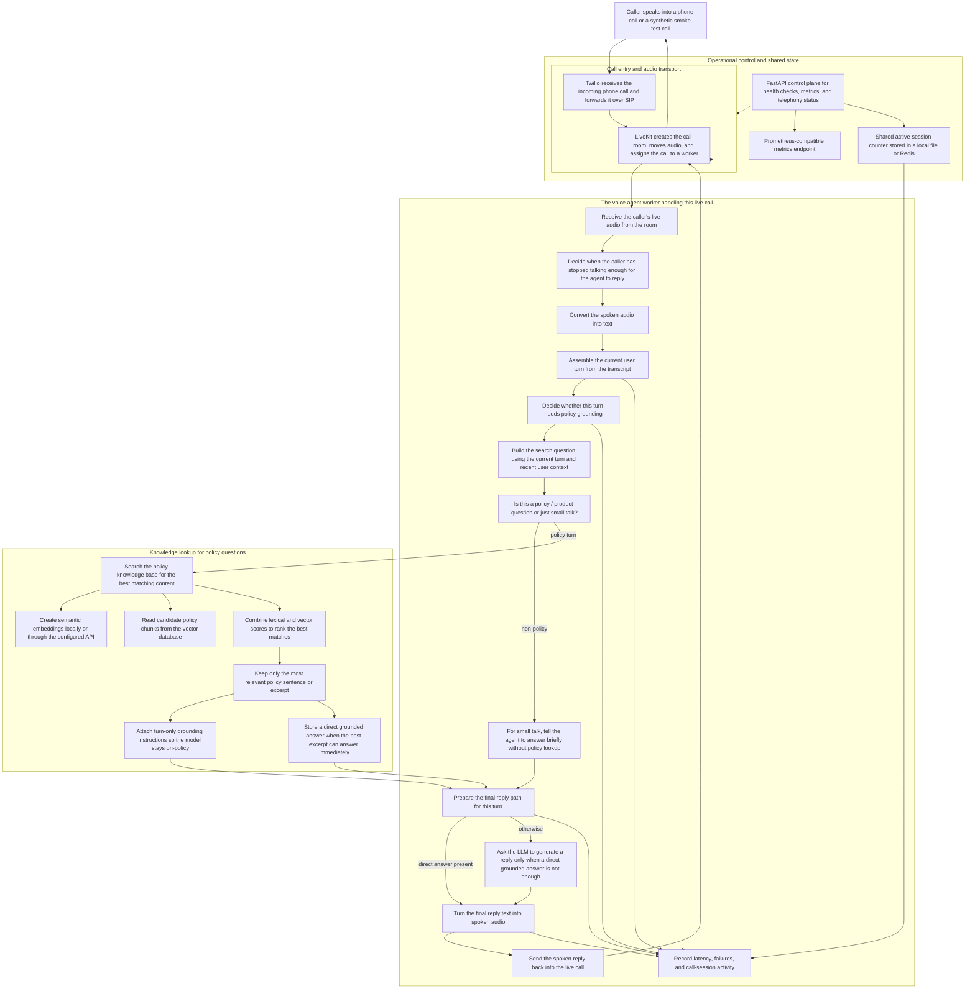

# Architecture And Trade-Offs

## 1. Unified End-To-End Flow

## Why this is the real current flow

- It shows the real runtime split between:
  - SIP / media ingress
  - media transport
  - turn detection
  - grounding
  - text generation
  - speech synthesis
  - control-plane visibility and provisioning
- It makes the current bottlenecks explicit:
  - endpointing / turn boundary
  - live LLM path
  - first grounded-turn overhead
- It also shows the real fallback/recovery shape now in code:
  - small-talk bypass
  - retrieval-guided turn-scoped developer message
  - `llm_node(...)` recovery path when that guidance is missing

## Why this shape exists

- LiveKit owns SIP/media ingress and worker dispatch.
- The worker owns turn handling, grounding, reply generation, and speech synthesis.
- Retrieval stays behind a boundary so it can remain local now and move out of process later if needed.
- The FastAPI control plane is not in the live reply path; it owns health, metrics, and telephony provisioning/status.

## LiveKit vs Pipecat

### LiveKit

Pros:
- Built-in real-time media routing
- Strong SIP / telephony support
- Native worker/session model
- Good fit for PSTN and multi-party media

Cons:
- Heavier setup than a simple Python pipeline
- Real-time debugging can be harder
- More operational surface area

Best when:
- telephony is first-class
- you need SFU/media routing
- you want built-in room/session orchestration

### Pipecat

Pros:
- Lightweight Python-first pipeline model
- Easier to prototype custom AI/media steps
- Good for non-telephony experiments

Cons:
- Does not replace a media server
- You still need separate WebRTC/SIP infrastructure
- More integration work for PSTN-grade routing

Best when:
- you want a custom Python pipeline
- telephony/media routing is handled elsewhere
- you are optimizing experimentation speed over integrated infra

## Current measured bottleneck summary

- Retrieval is no longer the dominant bottleneck in the best local/local path.
- The main remaining latency is in:
  - end-of-turn / endpointing delay
  - LLM TTFT
  - full spoken-response path

Latest proven successful default smoke:
- response latency: about `9019 ms`
- worker turn snapshot:
  - EOU: about `552 ms`
  - LLM TTFT: about `2678 ms`
  - TTS TTFB: about `216 ms`

## 1-Pager: What breaks at 1000 calls?

### What breaks first

1. LLM provider limits and latency
- the current text path is already the largest measured delay
- free/demo tiers will not sustain real high concurrency

2. Worker memory footprint
- local embeddings inside worker processes do not scale cleanly to very high worker counts

3. Local file-backed metrics/state
- JSONL turn logs and file-backed active-session state are fine for this prototype, not for large distributed scale

4. Retrieval ownership inside workers
- acceptable for this repo
- not the right final shape for large corpora and many workers

5. Honest admission control
- one overloaded worker must stop accepting work
- otherwise failures turn into slow no-answer behavior

### How to fix it

1. Move retrieval out of the worker into a shared service
2. Keep workers thin and capacity-bound
3. Replace local file-backed metrics/state with a proper shared telemetry backend
4. Use paid/provider-appropriate LLM and telephony tiers
5. Scale workers horizontally and validate at stepped concurrency, not by assumption

### Where is the bottleneck today?

- the voice / LLM path, not the vector DB path
- specifically:
  - turn-finalization delay
  - LLM TTFT

## Honest conclusion

- The current system is a working prototype with real telephony ingress and grounded answers.
- It is not yet meeting the current latency target.
- The right next improvements are operational proof and honest scaling evidence, not more speculative architecture churn.
