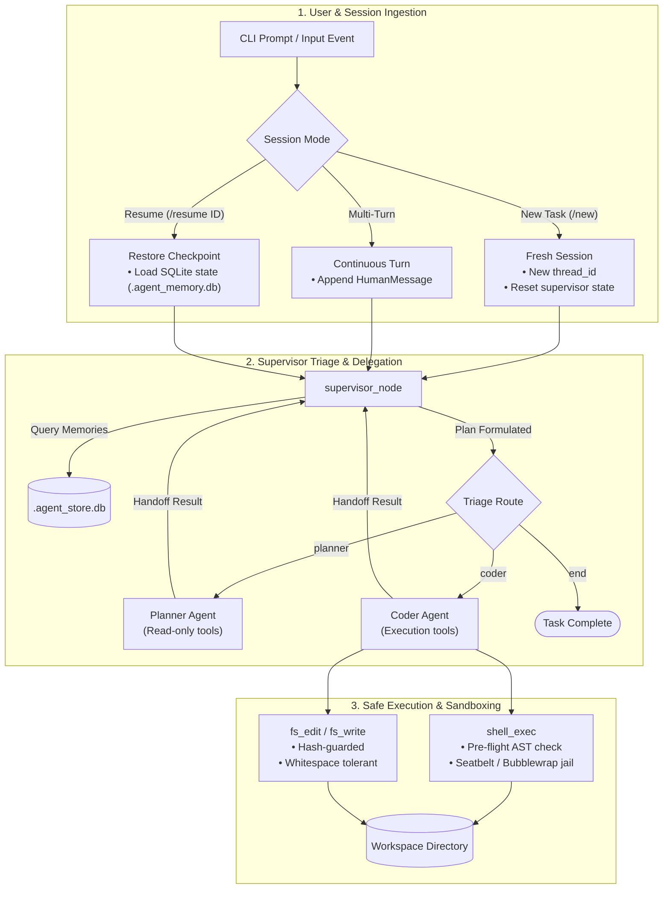

# General Coding Agent

**On-device, autonomous software engineering agent with cryptographic state safety, boundary sandboxing, and zero external infra dependencies.**

`general-coding-agent` is an industrial-grade, multi-agent pair programming system built on LangGraph. It runs 100% locally on your machine, requiring no external databases, no Redis, and no container infrastructure for standard execution. It persists state via embedded SQLite, enforces compile-time worker tool isolation, sandboxes shell execution with pre-flight AST parsing and OS-level confinement, and manages large codebases via non-destructive token compaction.

---

## Engineering Highlights

- **Zero External Infrastructure**: Uses native embedded SQLite (`AsyncSqliteSaver` checkpointer and `AsyncSqliteStore`). Runs standalone on any machine with Python 3.12+ and an LLM API key or local vLLM/Ollama endpoint.
- **Hierarchical Supervisor-Worker Architecture**: A supervisor model triages incoming tasks, formulates structured plans (TODOs), and delegates dynamically between isolated roles:
  - `planner`: Read-only reasoning agent with paged file viewing, memory search, and skill discovery.
  - `coder`: Execution agent with file editing, creation, and sandboxed shell command execution.
- **Pre-Flight AST & Syntax Sandbox**: Inspects command syntax before execution; blocks command substitutions (`$(...)`, backticks), process substitutions, background detachment (`&`), and shell variable mutations (`export`, `set`).
- **OS-Level Process Confinement**: Wraps commands in macOS Seatbelt (`sandbox-exec`) or Linux Bubblewrap (`bwrap`) to enforce that file modifications remain strictly bound to `workspace_root`.
- **Fuzzy Whitespace-Tolerant Patching (`fs_edit`)**: Exact substring matching as fast path, with automatic tolerance for trailing whitespace differences and uniform indentation shifts (e.g. 4-space prompt vs 8/12-space class nesting). Fails closed on ambiguous matches.
- **Cryptographic Human-in-the-Loop (HIL) Approvals**: Binds approval tickets to canonical argument hashes (`canonical_args_hash`) to prevent tampering across graph pause/resume cycles.
- **Deterministic Secret Detection**: Rejects memory writes containing API keys, AWS credentials, or tokens before writing to persistent storage.
- **Non-Destructive Token Compaction**: When context exceeds thresholds, older turns are structured into compact summaries while keeping full tool-call and message fidelity in SQLite.

---

## Architecture



---

## Directory Structure

```
general-coding-agent/
├── src/general_coding_agent/
│   ├── config.py           # Pydantic v2 settings & environment configuration
│   ├── graph.py            # LangGraph multi-agent supervisor/worker workflow
│   ├── llm.py              # Multi-provider LLM factory (Gemini, Claude, OpenAI, vLLM)
│   ├── prompts.py          # System prompts for supervisor, planner, coder
│   ├── state.py            # Typed agent schemas & compaction data structures
│   ├── memory/
│   │   ├── checkpointer.py # Thread persistence with AsyncSqliteSaver
│   │   └── store.py        # Long-term memory & secret rejection with AsyncSqliteStore
│   ├── skills/
│   │   └── manager.py      # Progressive disclosure skill catalog
│   └── tools/
│       ├── artifacts.py    # Large tool output bounding & truncation
│       ├── execution.py    # Durable wrapper, reconciliation & approval gates
│       ├── fs.py           # Sandboxed filesystem & shell tools
│       ├── planning.py     # Todo planning & task tracking tools
│       └── registry.py     # Compile-time tool isolation for planner & coder
├── tests/
│   └── test_agent.py       # 44 comprehensive integration and unit tests
├── skills/                 # Bundled skills catalogue (e.g. python-debugging)
├── main.py                 # Interactive terminal CLI with token streaming
├── pyproject.toml          # Package configuration & dependencies
├── .env.example            # Sample configuration file
└── .gitignore              # Local DB & secret exclusions
```

---

## Quick Start

### 1. Requirements
- Python 3.12+
- [`uv`](https://docs.astral.sh/uv/) (recommended) or standard `pip`

### 2. Setup
```bash
# Clone and navigate to the agent directory
cd scalable-ai-agents/general-coding-agent

# Create your local .env configuration
cp .env.example .env

# Set your API key in .env (Gemini, Anthropic, OpenAI, or local vLLM)
# Example: GEMINI_API_KEY=AIzaSy...
```

### 3. Run the Interactive CLI
```bash
# Launch interactive coding session
uv run python main.py

# Or run with a direct task prompt
uv run python main.py "Inspect this repository and fix test failures"
```

### 4. Interactive Commands
While in the interactive session, you can use:
- `/plan` — View the current structured task list and status.
- `/skills` — List loaded progressive disclosure skills.
- `/new` — Start a fresh session with a new thread ID.
- `/exit` — Quit the session cleanly.

---

## Running the Test Suite

The test suite validates sandboxing, memory integrity, fuzzy patching, command AST scanning, and tool isolation across 44 end-to-end and unit tests:

```bash
uv run pytest -v
```

---

## License

MIT
