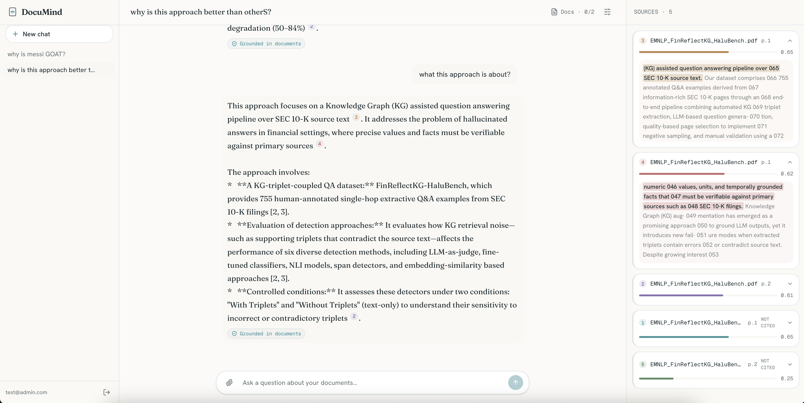
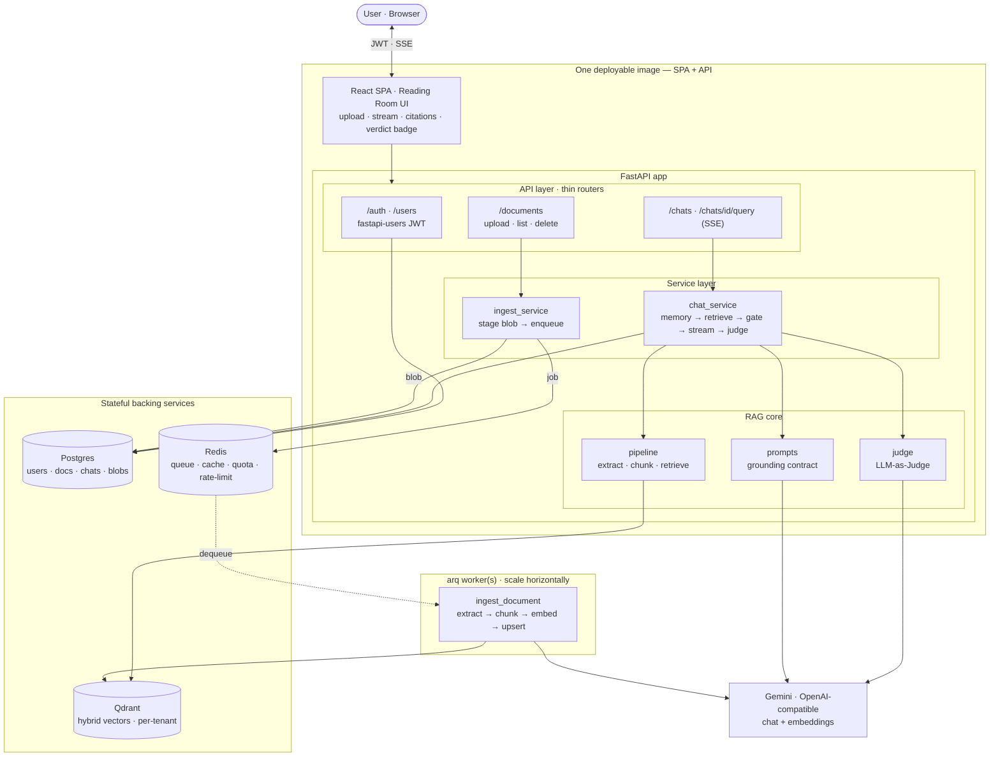

<div align="center">

# 📄 DocuMind

### Document-grounded RAG assistant

Answers questions **only** from your uploaded documents (PDF · DOCX · DOC · TXT · MD), with inline
citations, and clearly says *"I couldn't find that in your documents"* when the answer isn't there —
instead of hallucinating. Every answer is scored in realtime by an LLM judge for groundedness.



</div>

## Features

**Documents & retrieval**
- Upload one or more files (**PDF · DOCX · DOC · TXT · MD**, mixed in one request) → extracted,
  chunked, embedded, and indexed in Qdrant.
- **Hybrid search**: dense (cosine) + BM25 sparse, fused with Reciprocal Rank Fusion in Qdrant.
- **Per-user document library + per-chat scope**: files are uploaded once (embedded once) and reused
  across chats; each chat chooses *which* documents it queries (default: all).
- **Upload de-duplication**: identical content (SHA-256) is reused instead of re-embedded.

**Answering & provenance**
- Streams the answer **token-by-token** (SSE) with inline `[n]` citations.
- **Sources panel**: one card per retrieved passage — filename · page · **similarity score** · snippet,
  colour-matched to the `[n]` chips (hover to link both).
- **Line-level provenance**: the exact span the answer drew from each source is **highlighted** inside
  the snippet; cited sources auto-expand and sort to the top, uncited ones collapse.
- **Refuses** when nothing relevant is found — two-layer guard: a similarity gate (no LLM call) + a
  strict prompt contract — instead of hallucinating.
- **Live grounding verdict** (LLM-as-Judge): every answer is scored for **source / grounded / correct**
  and shown as a badge under it.

**Chat**
- Multi-chat with **conversation history** (verbatim recent window + rolling summary of older turns).
- **Edit the last message**: removes that turn *and* its answer, then re-asks the edited question.
- **Per-chat settings** (one popover): model, top-k, min-similarity, temperature, history turns,
  context budget, chunk size/overlap (chunking applies to new uploads).
- **Model picker**: choose the chat model per chat from a configurable list (no code change).

**Platform**
- **Multi-user JWT auth** (register / login / password reset / email verify); each user's documents
  and chats are fully isolated (per-tenant filter on every query).
- **Async ingestion** via an arq worker (upload returns immediately; UI polls status).
- **Human-readable errors everywhere** — no raw provider/framework codes reach the client.
- **Scalable & portable**: stateless API, bounded concurrency, per-user token quota + concurrency caps,
  rate limiting, Prometheus metrics, structured logs; deploys as one image to any container host.

## Architecture



- **API layer** (`app/api/`) — thin routers: auth, documents, chats. Parse → call service → map result.
- **Service layer** (`app/services/`) — `ingest_service` (stage + dispatch ingestion), `chat_service`
  (retrieve → gate → stream → persist → judge, with rolling conversation memory).
- **RAG core** (`app/rag/`) — `extract` (format → text), `chunk` (recursive splitter), `vectorstore`
  (Qdrant, per-tenant filter), `pipeline` (ingest + retrieve), `prompts` (grounding contract), `judge`.
- **Integrations** — `llm.py` (one OpenAI-compatible client for chat + embeddings, reused; circuit
  breaker + query-embedding cache), `db/` (async SQLAlchemy), `redis_client`, `quota`/`plans`.
- **Ingestion is async**: upload returns immediately (`pending`); an arq worker embeds and indexes
  (`processing → ready`), so large PDFs never block the request path. Idempotent + retried.
- **Stateless & portable**: no local disk — raw upload bytes are staged transiently in Postgres
  (`document_blobs`) so any API replica or worker reads them. Deploys to Railway / Render / Fly / any
  managed Postgres + Redis + Qdrant, and scales horizontally.

## Technologies

| Concern | Choice |
|---|---|
| API | FastAPI, Uvicorn, SSE (`sse-starlette`) |
| Auth | `fastapi-users` (JWT, argon2/bcrypt, reset/verify) |
| LLM + embeddings | `openai` SDK → Gemini OpenAI-compatible endpoint; chat model **per-chat selectable** (`gemini-3.1-flash-lite` default, `gemini-3.5-flash`, `gemini-2.5-flash`), embeddings `gemini-embedding-2` |
| Grounding eval | LLM-as-Judge (`app/rag/judge.py`) — source / grounded / correct + used-span extraction |
| Vector DB | Qdrant (async client, per-tenant filter, **hybrid dense + BM25/RRF**) |
| Sparse vectors | `fastembed` (BM25, computed locally) |
| Relational DB | Postgres (prod) / SQLite (tests), async SQLAlchemy |
| Queue / cache / rate-limit | Redis + `arq` worker |
| Extraction | `pypdf`, `python-docx`, `antiword` (.doc), text |
| Chunking | `langchain-text-splitters` (recursive) |
| Rate limiting / metrics / logs | `slowapi`, Prometheus, `structlog` |
| Tooling | `uv`, `ruff`, `mypy`, `pytest` |

## Run it — one command

Prerequisites: **Docker** and a **Gemini API key** — free; see
[how to get an API key](https://ai.google.dev/gemini-api/docs/api-key) (or grab one directly at
[aistudio.google.com/apikey](https://aistudio.google.com/apikey)).

```bash
export GEMINI_API_KEY=your_key_here   # or edit the .env it generates
make up
```

That's it. `make up` writes a `.env` (random `JWT_SECRET` + your key) if one doesn't exist, then
builds and starts the **whole stack** — Postgres, Redis, Qdrant, the API+UI, and the ingestion worker:

- **Web UI + API → http://localhost:8000**
- **Swagger → http://localhost:8000/docs**

The API serves the built web UI from the same origin, so it's one port and one image. `make down`
stops it (keeps data); `make logs` tails everything; `make test` runs unit+smoke tests.

<details>
<summary>Without <code>make</code> (plain Docker), or frontend hot-reload for development</summary>

```bash
# Plain Docker — create .env once, then up:
printf 'GEMINI_API_KEY=%s\nJWT_SECRET=%s\n' "$GEMINI_API_KEY" \
  "$(python3 -c 'import secrets; print(secrets.token_urlsafe(48))')" > .env
docker compose up --build

# Frontend hot-reload (backend must be running on :8000):
cd frontend && npm install && VITE_API_URL=http://localhost:8000 npm run dev   # → :5173

# Backend only, no Docker (needs reachable Qdrant + Redis):
cd backend && uv sync && cp .env.example .env   # set GEMINI_API_KEY
uv run uvicorn app.main:app --reload            # INGEST_EXECUTOR defaults to "inline" — no worker needed
```

</details>

## Deploy anywhere (Railway · Render · Fly · any container host)

The repo is built to be picked up with **zero code changes**:

- **One Dockerfile** at the repo root builds the SPA and serves it from the API — platforms that
  auto-detect a Dockerfile just work. It binds to `$PORT` (falls back to 8000).
- **Fully env-driven config** (`app/config.py`) — nothing hardcoded. A platform-injected
  `DATABASE_URL` (`postgres://…` / `postgresql://…`) is **auto-normalized** to the async driver, so
  Railway/Render Postgres plugins connect with no edits.
- **Health check** at `/health` (liveness) and `/health/ready` (DB + Redis + Qdrant readiness).
- **Single service works out of the box**: with `INGEST_EXECUTOR=inline` (the default) ingestion runs
  in-process — no separate worker needed. Set `INGEST_EXECUTOR=queue` and run a second service
  (`arq app.worker.WorkerSettings`) to scale ingestion independently.

**Required env vars:** `GEMINI_API_KEY`, `JWT_SECRET` (any long random string), `DATABASE_URL`,
`REDIS_URL`, `QDRANT_URL` (+ `QDRANT_API_KEY` for Qdrant Cloud). Point them at managed Postgres,
Redis, and Qdrant Cloud and deploy. For Kubernetes, a Helm chart is in `deploy/helm/documind/`.

## API usage (curl)

```bash
API=http://localhost:8000
# register + login
curl -s -X POST $API/auth/register -H 'Content-Type: application/json' \
  -d '{"email":"me@example.com","password":"a-strong-password"}'
TOKEN=$(curl -s -X POST $API/auth/jwt/login \
  -d 'username=me@example.com&password=a-strong-password' | jq -r .access_token)

# upload documents (mixed formats allowed)
curl -s -X POST $API/documents -H "Authorization: Bearer $TOKEN" \
  -F "files=@sample_docs/SAMPLE_PDF.pdf" -F "files=@sample_docs/SAMPLE_MD.md"

# poll status until "ready"
curl -s $API/documents -H "Authorization: Bearer $TOKEN"

# create a chat, then ask.
# SSE stream: `token` deltas → `done` {message_id, citations, grounded} → `verdict`
# {source, grounded, correct, citations-with-used_quote}  (or `error`).
CHAT=$(curl -s -X POST $API/chats -H "Authorization: Bearer $TOKEN" \
  -H 'Content-Type: application/json' -d '{"title":"demo"}' | jq -r .id)
curl -N -X POST $API/chats/$CHAT/query -H "Authorization: Bearer $TOKEN" \
  -H 'Content-Type: application/json' -d '{"question":"What is this document about?"}'

# list selectable models · scope a chat to specific docs · edit (drop) the last exchange
curl -s $API/chats/models -H "Authorization: Bearer $TOKEN"
curl -s -X PATCH $API/chats/$CHAT -H "Authorization: Bearer $TOKEN" \
  -H 'Content-Type: application/json' -d '{"model":"gemini-2.5-flash","document_ids":["<doc-id>"]}'
curl -s -X DELETE $API/chats/$CHAT/messages/last -H "Authorization: Bearer $TOKEN"
```

**Per-chat settings** (one contract, `PATCH /chats/{id}`, defaults from config, validated ranges):
`model`, `top_k`, `min_score`, `history_turns`, `context_token_budget`, `temperature`,
`chunk_size`, `chunk_overlap`, and `document_ids` (the chat's document scope; `null` = all).
`chunk_size`/`chunk_overlap` apply to **documents uploaded from then on** (existing docs keep theirs);
they can also be overridden per upload via `?chunk_size=&chunk_overlap=` on `POST /documents`.

## Configuration

All config is centralized in `app/config.py` and env-driven — change a URL/model/key/threshold in one
place. Key vars:

- **Provider**: `GEMINI_API_KEY`, `LLM_BASE_URL`, `CHAT_MODEL`, `AVAILABLE_CHAT_MODELS` (comma-sep
  dropdown list), `EMBED_MODEL`, `EMBED_DIM`.
- **Infra**: `DATABASE_URL`, `REDIS_URL`, `QDRANT_URL` (+ `QDRANT_API_KEY`), `INGEST_EXECUTOR`
  (`inline`|`queue`).
- **Auth/security**: `JWT_SECRET`, `MIN_PASSWORD_LENGTH`, `AUTH_MAX_PER_MIN`, `CORS_ORIGINS`.
- **RAG/eval defaults**: `CHUNK_SIZE` (768), `CHUNK_OVERLAP` (128), `RETRIEVAL_TOP_K`,
  `RETRIEVAL_MIN_SCORE`, `JUDGE_ENABLED` (on; one extra LLM call per answered query).

Swapping to any OpenAI-compatible provider is just `LLM_BASE_URL` + models + key. See
`backend/.env.example`.

## Testing

```bash
cd backend
uv run ruff check app tests && uv run mypy app
uv run pytest tests/unit tests/smoke          # no external services needed
uv run pytest tests/integration               # needs GEMINI_API_KEY + a reachable Qdrant (real E2E)
```

- **Unit** — chunking, extraction, memory windowing, settings validation, retrieval gate.
- **Integration** — real Gemini + real Qdrant: upload → ingest → grounded answer with citations →
  "no info" refusal → tenant isolation → 415. Skips automatically without the key/Qdrant.
- **Smoke** — app boot, `/health`, `/health/ready`, auth required.

### Evaluation — LLM-as-Judge (online + offline)

Every answer is scored by an LLM judge against the question, the **retrieved context**, and the
**prior conversation** for three things: **source** (did the answer come from the documents, the
conversation, both, or neither), **groundedness** (is every claim supported — no fabrication), and
**correctness**. One judge definition (`app/rag/judge.py`) powers both modes.

- **Online (in the request path).** After the answer and its citations stream to the user, the judge
  runs and the verdict arrives as a trailing `verdict` SSE event — so judging never delays what the
  user reads. The verdict is persisted on the message and shown in the UI as a badge under the answer
  ("Grounded in documents" / "…in conversation" / "Unverified — may contain unsupported claims").
  Toggle with `JUDGE_ENABLED` (default on; costs one extra LLM call per answered query).

- **Offline (batch regression).** `scripts/eval.py` runs a gold Q/A set (`scripts/eval_dataset.json`)
  through the real pipeline and scores each answer with the same judge, reporting pass/fail, a
  hallucination count, and refusal accuracy. Cases cover the scenarios: answerable-from-document,
  answerable-from-conversation-history, and genuinely-absent (must refuse).

  ```bash
  cd backend
  QDRANT_COLLECTION=eval_tmp uv run python scripts/eval.py   # needs GEMINI_API_KEY + Qdrant + Redis
  ```

## Requirements coverage (TASK.md)

Every requirement, deliverable, and engineering item mapped to where it lives.

| # | Requirement | Where |
|---|---|---|
| 1 | REST API in Python (FastAPI) | `app/main.py`, `app/api/` |
| 2 | Upload one or more PDF / DOCX / TXT (+DOC +MD) | `POST /documents` (`api/documents.py`), multi-file |
| 3 | Extract & prepare content | `rag/extract.py` → `rag/chunk.py` |
| 4 | Vector database | Qdrant (`rag/vectorstore.py`), hybrid dense + BM25 |
| 5 | RAG pipeline | `rag/pipeline.py` (`ingest` / `retrieve`) + `chat_service` |
| 6 | Answer + document(s) + snippet/reference | SSE: answer + `citations[]` (filename · page · score · snippet) + **line-level used-span highlight** in the Sources panel |
| 7 | Refuse when not in documents | Two layers: score gate (`pipeline.retrieve`) + prompt contract (`rag/prompts.py`) |
| 8 | Clean, maintainable code | Thin routers → services → RAG core; `ruff` + `mypy` clean |
| 9 | README (arch/tech/setup/run/limits) | This file |
| **Deliverables** | Source · README · `requirements.txt` · API docs · sample docs | repo · here · `backend/requirements.txt` · Swagger `/docs` · `sample_docs/` |
| **Eng** | Docker | root `Dockerfile` + `docker-compose.yml` + Helm |
| **Eng** | Authentication | `fastapi-users` JWT (`app/users.py`) — register/login/reset/verify |
| **Eng** | Conversation history | `MessageDB` + verbatim window + rolling summary (`chat_service.split_window`) |
| **Eng** | Streaming responses | SSE over `fetch`/`ReadableStream` (`api/stream.ts`) |
| **Eng** | Tests: integration / unit / smoke | `backend/tests/{integration,unit,smoke}` |
| **Eng** | Simple web interface | React SPA (`frontend/`), served same-origin |
| **Criteria** | Error handling + logging | `errors.py` taxonomy, `structlog` + request-id correlation |
| **Criteria** | Scalability / concurrency | async end-to-end, arq worker, bounded embed fan-out, per-user quota/concurrency, load-shed |
| **Criteria** | CI/CD | `.github/workflows/ci.yml` (ruff + mypy + pytest + docker build) |
| **Criteria** | Config / centralization / extensibility | single `app/config.py`, per-chat settings, provider-swappable LLM |
| **Extra** | Grounding evaluation | LLM-as-Judge online (verdict badge) + offline harness (`scripts/eval.py`) |

## Assumptions & limitations

- **Single shared Gemini key** (server-side); the model is user-selectable from a fixed list, but full
  BYOK (arbitrary key/URL per user) is intentionally out of scope — swap the provider via config.
  Per-user *usage* quota + concurrency caps are enforced. Free-tier embedding quota (~100 req/min) can
  429 on bulk/large ingest — handled gracefully (document goes `failed`, idempotent & retryable); a
  paid tier removes this.
- **Retrieval is hybrid** — dense (cosine) + BM25 sparse fused with RRF in Qdrant; the dense cosine is
  the per-source similarity score shown to users and drives the "no info" gate.
- **Line-level highlighting is best-effort**: a source the answer cites always appears as *cited*
  (expanded); the exact span is highlighted only when the judge can locate a verbatim substring —
  paraphrased sources show the full cited snippet without a sub-highlight.
- **De-duplication is per-user by exact content** (SHA-256); a re-upload of identical bytes reuses the
  existing document. Changing chunk size only affects **new** uploads (existing docs keep their chunking).
- **Errors are humanized centrally** (exception handlers map framework/provider codes → plain messages);
  every error response is `{"detail": "<readable>"}`.
- **`create_all` schema bootstrap**, no Alembic migrations yet (v1) — schema changes need a fresh DB
  (`docker compose down -v`); swap in migrations for prod. Likewise a Qdrant collection from an older
  schema is detected and reported, not silently reused.
- Transient upload bytes live in Postgres (fine at this scale); move to object storage for very large
  corpora. TLS terminates at the ingress/load balancer (not the app).
